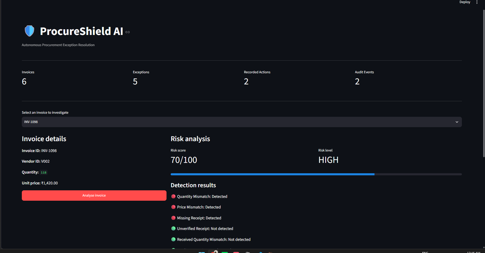

# ProcureShield AI 🛡️

### Procurement Invoice Exception Resolution Prototype

**Detect. Decide. Record. Verify.**

ProcureShield AI is a Python prototype that compares procurement invoices with purchase orders and delivery records, applies transparent rule-based risk scoring, recommends a next action, records simulated actions, and checks the resulting database records.



*Screenshot of the running local Streamlit prototype. Actions shown in the application are simulated; no real payment system is connected.*

## What it currently does

- Reads invoice, purchase-order, vendor, and delivery-receipt data from SQLite.
- Detects quantity mismatches, price mismatches, missing receipts, unverified receipts, received-quantity mismatches, and a simple vendor-risk threshold.
- Calculates a weighted heuristic risk score from 0 to 100 and classifies the score as LOW, MEDIUM, HIGH, or CRITICAL.
- Recommends a decision using deterministic rules: `APPROVE`, `HOLD_PAYMENT`, `REQUEST_EVIDENCE`, or `ESCALATE`.
- Records simulated actions and audit events in SQLite.
- Checks whether simulated action records are present.
- Provides a Streamlit dashboard to analyse demo invoices and view decisions and action-verification results.

## Current limitations

- This is a prototype, not a production procurement or financial system.
- The risk score is a weighted rule-based heuristic, not a trained model or a calibrated probability of fraud.
- Duplicate-invoice detection is not implemented yet; its current flag is always false.
- Actions are simulated. The prototype does not actually hold/release payments or send vendor messages.
- Verification checks local database records, not an external payment, ERP, or email system.
- Authentication, role-based access control, migration management, and production deployment hardening are not implemented.
- The included examples are synthetic demo data, not real supplier or customer records.

## Technology stack

- Python
- SQLite (Python standard library)
- Streamlit
- Git and GitHub

`requirements.txt` lists the dashboard's direct runtime dependency. SQLite support comes with Python and does not need a separate package.

## Project structure

```text
procureshield-ai/
├── app/
│   ├── __init__.py
│   ├── database/
│   │   ├── __init__.py
│   │   ├── db.py
│   │   ├── check_db.py
│   │   └── check_invoice.py
│   └── services/
│       ├── __init__.py
│       ├── detection_engine.py
│       ├── test_detection.py
│       ├── decision_agent.py
│       ├── action_executor.py
│       ├── verify_actions.py
│       └── seed_data.py
├── assets/
│   └── procureshield-dashboard.png
├── dashboard/
│   └── app.py
├── data/                 # local SQLite file is generated here
├── requirements.txt
├── .gitignore
└── README.md
```

## Run locally (Windows PowerShell)

### 1. Clone the repository

```powershell
git clone https://github.com/sglovescoffee/procureshield-ai.git
cd procureshield-ai
```

### 2. Create and activate a virtual environment

```powershell
python -m venv .venv
.\.venv\Scripts\Activate.ps1
```

### 3. Install dependencies

```powershell
python -m pip install -r requirements.txt
```

### 4. Initialise the database and load the demo data

```powershell
python -m app.database.db
python -m app.services.seed_data
```

**Warning:** `seed_data.py` clears and recreates the prototype's demo rows in the local tables. Run it only when you are comfortable resetting your local demo data.

### 5. Start the dashboard

```powershell
python -m streamlit run dashboard/app.py
```

Open the local URL shown in the terminal, typically `http://localhost:8501`.

## Demo scenario: `INV-1098`

The seeded demonstration invoice intentionally differs from its purchase order:

| Field | Purchase order | Invoice |
|---|---:|---:|
| Quantity | 100 | 118 |
| Unit price | ₹1,250 | ₹1,420 |

The corresponding delivery receipt is intentionally missing. With the current weights, these three signals produce a score of `70/100`, classified as `HIGH`. The rule-based decision is `HOLD_PAYMENT`; because the receipt is missing, the simulated workflow also records `REQUEST_EVIDENCE`.

These are configured demo rules, not evidence that the invoice is fraudulent.

## Risk scoring used by the prototype

| Signal | Weight |
|---|---:|
| Quantity mismatch | 25 | 
| Price mismatch | 25 |
| Missing or inconsistent delivery evidence | 20 |
| Duplicate invoice | 20 (reserved; duplicate check not implemented) |
| Vendor risk threshold | 10 |

Risk bands: `LOW` = 0–25, `MEDIUM` = 26–50, `HIGH` = 51–75, `CRITICAL` = 76–100.

## Privacy, credentials, and local data

- Do not commit `.env`, `.env.*`, API keys, passwords, or credential files.
- `.gitignore` excludes environment files, Streamlit secrets, local virtual environments, and local SQLite database files.
- The application creates `data/procureshield.db` locally after setup. The database should be generated from the seed script rather than committed as a binary artifact.
- Use synthetic sample data only. Do not add actual vendor invoices, customer information, or confidential company records to this public repository.
- If a real secret was committed in the past, removing it from the latest version is not sufficient: revoke/rotate it and assess repository history before sharing further.

## Future improvements

- Implement duplicate and near-duplicate invoice detection.
- Add automated tests with assertions and regression coverage.
- Model policy thresholds and receipt/partial-delivery cases explicitly.
- Improve database constraints, transaction handling, and action idempotency.
- Validate verification against expected action outcomes and, in a future integration, external-system responses.
- Add authentication, access controls, and operational monitoring before any production use.

## Project goal

ProcureShield AI explores how a transparent, auditable workflow can assist procurement teams with invoice exception triage. The current project is an early prototype intended for learning, experimentation, and further engineering.
